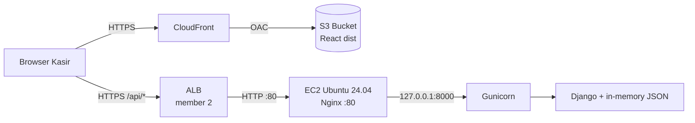

# Deployment — Cloud Infrastructure & Compute Engineer

Dokumen ini adalah runbook untuk **scope task 1** pada Tugas 9 Komputasi Awan:

1. S3 Bucket + CloudFront untuk frontend React
2. Provisioning EC2 Ubuntu untuk Django
3. Nginx + Gunicorn
4. Security Groups

ALB/Target Group/Auto Scaling, EFS, dan CloudWatch **tidak** termasuk scope ini
(dikerjakan anggota lain). Lihat bagian [Handoff](#handoff-ke-anggota-lain).

> Status: artefak siap dipakai, tetapi **belum dieksekusi di AWS** karena tidak
> ada akun AWS. Bukti yang tersedia berasal dari lab lokal (Nginx + Gunicorn).
> Soal 1 tetap memerlukan screenshot AWS Console asli dan tidak bisa digantikan
> simulasi.

---

## 1. Arsitektur



Yang menjadi tanggung jawab dokumen ini:

```text
S3 + CloudFront  →  frontend statis
EC2              →  compute backend
Nginx            →  reverse proxy :80 → Gunicorn
Gunicorn         →  WSGI server Django
Security Group   →  membatasi akses ke EC2
```

---

## 2. Peta file

| File | Fungsi |
| --- | --- |
| `deploy/terraform/` | S3, CloudFront, EC2, EIP, Security Group |
| `deploy/nginx/pos.conf` | Konfigurasi Nginx produksi di EC2 |
| `deploy/systemd/pos-backend.service` | Service Gunicorn |
| `deploy/gunicorn.conf.py` | Konfigurasi Gunicorn |
| `deploy/env/backend.env.example` | Template environment backend |
| `deploy/env/frontend.env.example` | Template `VITE_API_BASE_URL` |
| `deploy/scripts/setup-ec2.sh` | Provision EC2 (Ubuntu 24.04) |
| `deploy/scripts/cloud-init.sh.tftpl` | User-data EC2 dari Terraform |
| `deploy/scripts/deploy-frontend.sh` | Build → S3 → invalidasi CloudFront |
| `deploy/scripts/local-lab-up.sh` | Lab lokal Nginx + Gunicorn |
| `deploy/scripts/local-lab-down.sh` | Hentikan lab lokal |
| `deploy/scripts/verify-local-lab.sh` | Cek otomatis 12 kriteria lab lokal |

---

## 3. Prasyarat

- Terraform >= 1.6
- AWS CLI v2 (untuk upload frontend)
- Akun AWS + IAM user dengan izin S3, CloudFront, EC2, VPC
- EC2 Key Pair sudah dibuat di region target
- Node.js + npm (sudah ada)
- Python 3.12+ (Ubuntu 24.04)

Jika belum punya akun AWS, lewati langkah Terraform dan gunakan
[lab lokal](#6-lab-lokal-tanpa-aws) untuk bukti implementasi.

---

## 4. Deploy frontend ke S3 + CloudFront

### 4.1 Provision resource

```bash
cd deploy/terraform
cp terraform.tfvars.example terraform.tfvars
# edit terraform.tfvars: key_name dan admin_cidr wajib
terraform init
terraform fmt
terraform validate
terraform plan -out=tfplan
terraform apply tfplan
```

Output penting:

```bash
terraform output cloudfront_domain_name
terraform output cloudfront_distribution_id
terraform output s3_bucket_name
terraform output ec2_public_ip
```

### 4.2 Build dan upload

```bash
export S3_BUCKET="$(terraform -chdir=deploy/terraform output -raw s3_bucket_name)"
export CLOUDFRONT_DISTRIBUTION_ID="$(terraform -chdir=deploy/terraform output -raw cloudfront_distribution_id)"
export VITE_API_BASE_URL="https://<alb-dns>/api"   # dari member 2

bash deploy/scripts/deploy-frontend.sh
```

Skrip akan:

- build React dengan `VITE_API_BASE_URL`,
- upload aset dengan cache `immutable`,
- upload `index.html` dengan `no-cache`,
- invalidasi CloudFront `/*`.

### 4.3 Kenapa konfigurasi CloudFront seperti ini

| Kebutuhan | Implementasi |
| --- | --- |
| Bucket tidak publik | `aws_s3_bucket_public_access_block` + OAC |
| CloudFront boleh baca bucket | Bucket policy dengan principal `cloudfront.amazonaws.com` |
| SPA route dalam | Custom error 403/404 → `/index.html` (200) |
| `index.html` selalu baru | Ordered cache behavior `Managed-CachingDisabled` |
| Aset ber-hash | Default behavior `Managed-CachingOptimized` |
| HTTPS | `redirect-to-https` + sertifikat default CloudFront |

---

## 5. Provision EC2 + Nginx + Gunicorn

### 5.1 Melalui Terraform

`terraform apply` pada langkah 4.1 sudah membuat EC2 dan menjalankan
`cloud-init.sh.tftpl`, yang:

1. install `git`,
2. clone repo ke `/opt/pos`,
3. menjalankan `deploy/scripts/setup-ec2.sh`.

### 5.2 Manual di EC2

```bash
ssh -i <key>.pem ubuntu@<ec2-public-ip>

sudo apt-get update
sudo apt-get install -y git
sudo git clone --branch main https://github.com/kipling123/Tubes_PBO.git /opt/pos
sudo bash /opt/pos/deploy/scripts/setup-ec2.sh
```

### 5.3 Yang dilakukan `setup-ec2.sh`

- install `python3-venv`, `nginx`, `git`, `curl`;
- membuat user sistem `posapp`;
- membuat virtualenv di `/opt/pos/venv`;
- install `backend_django/requirements.txt`;
- membuat `/etc/pos/backend.env` dengan `DJANGO_SECRET_KEY` acak;
- mengambil public IP EC2 lewat **IMDSv2**;
- memasang systemd unit `pos-backend`;
- memasang Nginx site dan menghapus default site;
- `nginx -t`, enable, dan start service.

### 5.4 Verifikasi di EC2

```bash
systemctl status pos-backend --no-pager
systemctl status nginx --no-pager
curl -s http://127.0.0.1:8000/api/health/
curl -s http://127.0.0.1/api/health/
journalctl -u pos-backend -n 50 --no-pager
```

Contoh respons health:

```json
{"status": "ok"}
```

Respons sengaja minimal agar cocok dengan `backend_django/api/tests.py` dan
health check Target Group di `infra/aws/main.tf` (`matcher = "200"`).

### 5.5 Environment backend

Edit `/etc/pos/backend.env`:

```bash
sudo editor /etc/pos/backend.env
sudo systemctl restart pos-backend
```

Nilai penting:

| Variabel | Contoh produksi |
| --- | --- |
| `DJANGO_DEBUG` | `False` |
| `DJANGO_SECRET_KEY` | hasil `secrets.token_urlsafe(50)` |
| `DJANGO_ALLOWED_HOSTS` | `localhost,127.0.0.1,<ec2-ip>,<alb-dns>` |
| `CORS_ALLOWED_ORIGINS` | `https://<cloudfront-domain>` |
| `GUNICORN_WORKERS` | `3` |
| `GUNICORN_BIND` | `127.0.0.1:8000` |

---

## 6. Lab lokal (tanpa AWS)

Lab ini menjalankan stack yang sama tanpa AWS:

```text
Browser → Nginx :8080 → Gunicorn :8010 → Django
              └── menyajikan dist/ (simulasi S3 + CloudFront)
```

### 6.1 Jalankan

```bash
bash deploy/scripts/local-lab-up.sh
```

Buka:

- Frontend: <http://localhost:8080/>
- API: <http://localhost:8080/api/>
- Health: <http://localhost:8080/api/health/>

### 6.2 Verifikasi otomatis

```bash
bash deploy/scripts/verify-local-lab.sh
```

Script ini mengecek 12 hal dan mencetak `PASS`/`FAIL`:

- Gunicorn listen `:8010`, Nginx listen `:8080`;
- `GET /` mengembalikan `index.html`;
- SPA fallback `/cashier` mengembalikan `index.html`;
- `index.html` ber-`Cache-Control: no-cache`;
- aset `/assets/*` ber-`Cache-Control: immutable`;
- `/api/health/`, `/api/products/`, dan `/api/` sukses lewat proxy;
- header CORS untuk origin dev.

Contoh hasil:

```text
== Hasil: 12 PASS, 0 FAIL ==
```

Output inilah yang bisa di-screenshot sebagai bukti implementasi lokal.

### 6.3 Hentikan

```bash
bash deploy/scripts/local-lab-down.sh
```

### 6.4 Yang dibuktikan lab ini

- Build produksi React benar-benar disajikan Nginx.
- SPA fallback bekerja (`/cashier` tetap memuat `index.html`).
- Nginx mem-proxy `/api/*` ke Gunicorn.
- Gunicorn menjalankan Django WSGI (bukan `runserver`).
- `index.html` memakai `no-cache`; aset memakai `immutable`.
- Endpoint health siap dipakai health check.

> Catatan: ini **simulasi lokal**, bukan AWS. Jangan mengklaim screenshot lab
> sebagai AWS Console.

---

## 7. Security Groups

`deploy/terraform/security_groups.tf` membuat SG EC2 dengan aturan:

| Arah | Port | Source | Alasan |
| --- | --- | --- | --- |
| Ingress | 22 | `admin_cidr` | SSH hanya dari IP admin |
| Ingress | 80 | SG ALB | Hanya ALB yang boleh memanggil Nginx |
| Ingress | 80 | `0.0.0.0/0` (sementara) | Jika ALB belum ada |
| Ingress | 8000 | — | **Tidak pernah dibuka** |
| Egress | all | `0.0.0.0/0` | apt/pip/API keluar |

Gunicorn **wajib** bind ke `127.0.0.1:8000`, bukan `0.0.0.0:8000`.

---

## 8. Handoff ke anggota lain

| Interface | Disiapkan di sini | Dibutuhkan dari |
| --- | --- | --- |
| ALB → EC2 | SG menerima port 80 dari SG ALB | ID Security Group ALB |
| Health check | `GET /api/health/` (200 JSON) | Path/port Target Group |
| Frontend → API | `VITE_API_BASE_URL` saat build | DNS/URL ALB |
| EFS shared state | `ReadWritePaths` di systemd | Path mount EFS |
| HTTPS API | Nginx siap di belakang ALB | ACM/ALB dari member 2 |

Catatan penting untuk member 3 (EFS): `data_store.py` saat ini memuat JSON
sekali saat proses start dan menulis tanpa lock. Menaruh file di EFS saja
**tidak** membuat state konsisten antar instance. Perlu file lock + reload,
atau desain single-writer. Itu di luar scope task 1 dan sengaja tidak diubah.

---

## 9. Keterbatasan

1. Tidak ada akun AWS → Terraform belum di-`apply`, screenshot AWS Console
   (Soal 1) tetap menjadi blocker.
2. Tanpa ALB/domain, API belum punya HTTPS. Frontend CloudFront yang HTTPS
   tidak boleh memanggil API HTTP (mixed content). Solusi: sediakan ALB + ACM
   (member 2), atau tambahkan origin EC2 ke CloudFront untuk path `/api/*`.
3. Multi-instance/EFS belum konsisten sampai member 3 menambahkan locking.
4. `CORS_ALLOWED_ORIGINS` harus diisi domain CloudFront setelah distribusi jadi.
5. CloudFront butuh waktu 5–15 menit saat pembuatan/perubahan distribusi.

---

## 10. Estimasi biaya (region ap-southeast-1)

| Layanan | Perkiraan |
| --- | --- |
| EC2 t3.micro | ~US$7–8/bulan (atau gratis jika Free Tier) |
| EBS gp3 16 GB | ~US$1,3/bulan |
| Elastic IP (menempel) | gratis |
| S3 < 1 GB | < US$0,05/bulan |
| CloudFront | ~US$0,085/GB; ada kuota Free Tier |
| **Total demo** | **< US$10/bulan**, bisa US$0 dengan Free Tier |

Matikan EC2 setelah demo agar tidak terus tertagih.

---

## 11. Troubleshooting

| Gejala | Penyebab umum | Solusi |
| --- | --- | --- |
| `502 Bad Gateway` dari Nginx | Gunicorn mati | `systemctl status pos-backend`, cek log |
| `DisallowedHost` | Host tidak ada di `DJANGO_ALLOWED_HOSTS` | tambahkan IP/domain, restart |
| CORS error di browser | Origin CloudFront belum diizinkan | update `CORS_ALLOWED_ORIGINS` |
| CloudFront 403 | Bucket policy/OAC salah | cek policy dan OAC |
| Refresh route 404 | SPA fallback belum jalan | cek custom error 403/404 |
| `terraform apply` gagal | kredensial/region/key pair | cek `aws sts get-caller-identity` |
| `nginx -t` gagal | config/site default konflik | hapus `sites-enabled/default` |

---

## 12. Pemetaan ke laporan Tugas 9

| Bagian laporan | Isi dari repo ini |
| --- | --- |
| b.3 poin 1 (S3 & CloudFront) | `deploy/terraform/s3_cloudfront.tf` |
| b.3 poin 2 (EC2) | `deploy/terraform/ec2.tf`, `setup-ec2.sh` |
| b.3 poin 3 (Nginx/Gunicorn) | `deploy/nginx/pos.conf`, `gunicorn.conf.py`, systemd unit |
| Security Groups | `deploy/terraform/security_groups.tf` |
| Bukti implementasi | screenshot lab lokal + log health/checkout |

Untuk laporan, tulis bahwa eksekusi AWS belum dilakukan dan lampirkan bukti
lab lokal secara jujur.
