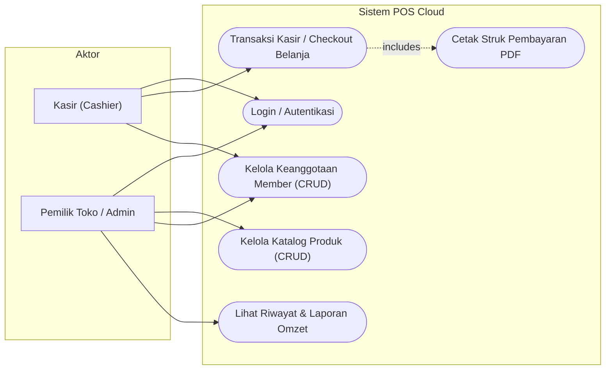
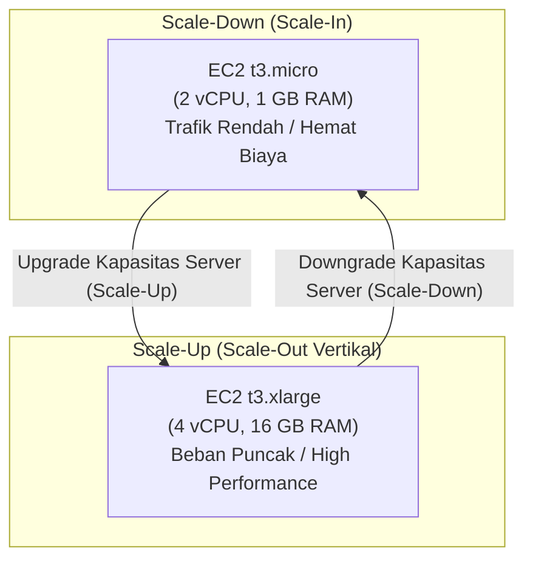
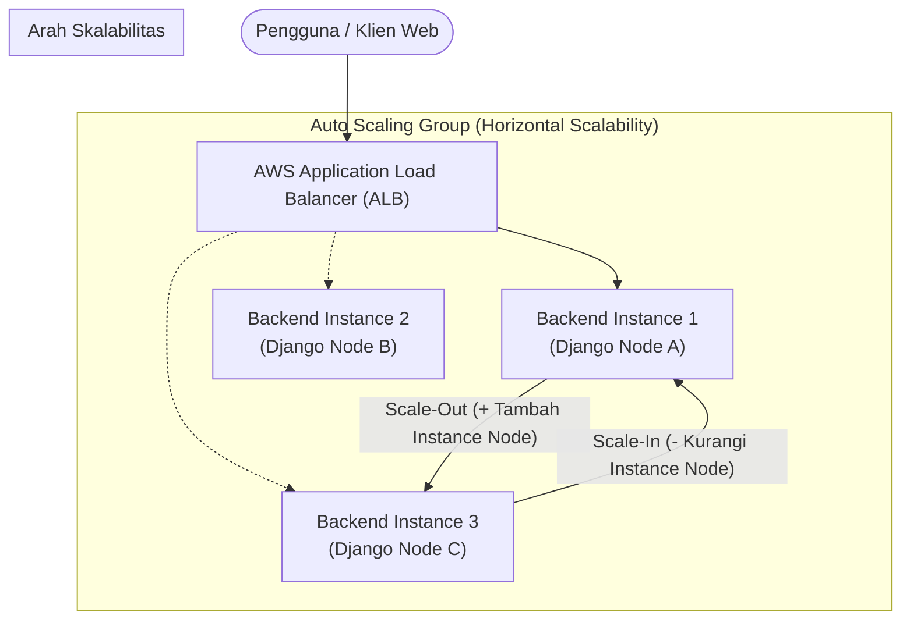
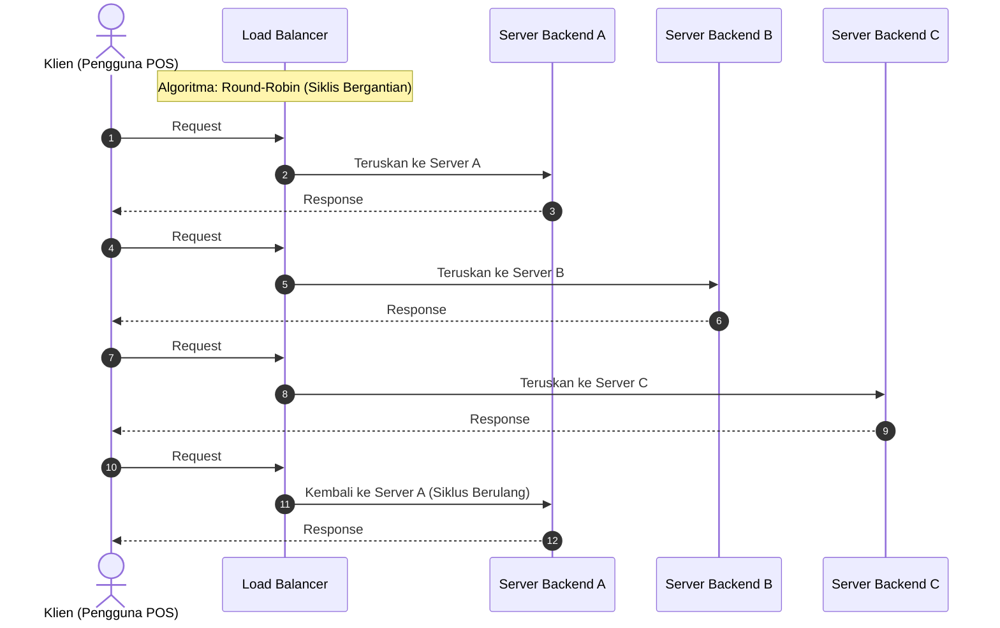
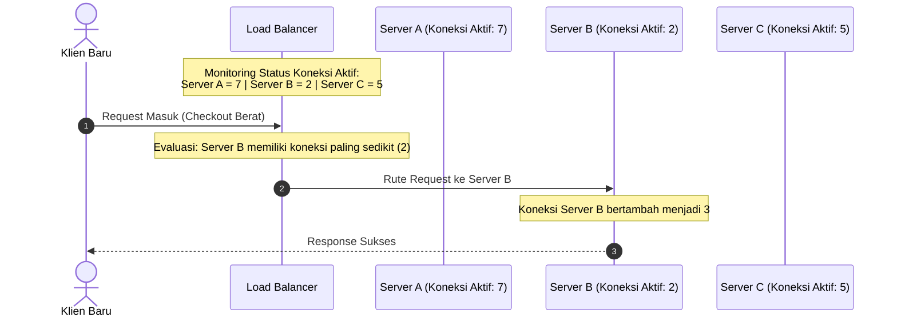
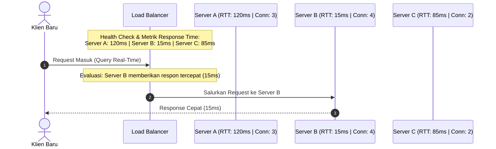

# TUGAS 9: KOMPUTASI AWAN DAN TERDISTRIBUSI (CAK3EAB3)
**Program Studi S1 Informatika – Fakultas Informatika – Universitas Telkom Bandung (2026)**

---

### Identitas Tugas & Pernyataan Kelompok

| **Mata Kuliah** | CAK3EAB3 Komputasi Awan dan Terdistribusi |
|---|---|
| **Tugas** | Tugas-9 (Arsitektur Web Cloud, Skalabilitas & Load Balancing) |
| **Kelompok** | Kelompok POS Cloud |
| **Kelas** | IF-XX-XX |
| **Dosen Pengampu** | Dosen Pengampu CAK3EAB3 |

#### PERNYATAAN
Saya menyatakan bahwa saya:
- (a) benar-benar ikut mengerjakan soal
- (b) telah menjelaskan jawaban saya ke teman anggota kelompok
- (c) telah memahami penjelasan dari teman anggota kelompok
- (d) tidak mencontek jawaban dari kelompok lain
- (e) tidak memberikan jawaban PR ini ke kelompok lain

| Nama Mahasiswa | NIM | Kontribusi Tugas | Tanda Tangan |
|---|---|---|---|
| Rafi Ikbar Fahrezy | 130xxxxxxxx | Arsitektur Backend Django, CRUD In-Memory Dict, Skalabilitas | *(Tanda Tangan)* |
| Anggota Kelompok 2 | 130xxxxxxxx | Frontend React, Integrasi API, Wireframe UI | *(Tanda Tangan)* |
| Anggota Kelompok 3 | 130xxxxxxxx | Use Case Diagram, Studi Load Balancing & Algoritma | *(Tanda Tangan)* |

---

## SOAL 1: AWS Account Setup (10 Poin) - ONSITE

### Panduan Screenshot Akun AWS:
1. Masuk ke AWS Management Console: [https://aws.amazon.com/console/](https://aws.amazon.com/console/)
2. Pastikan akun AWS Free Tier telah aktif.
3. Ambil screenshot layar penuh (*full screen*) yang memperlihatkan:
   - **Account ID** (12 digit nomor akun di pojok kanan atas).
   - **Nama Pengguna / Akun**: Root User atau IAM User.
   - **AWS Region**: e.g. `ap-southeast-1` (Singapore) atau `us-east-1` (N. Virginia).
   - **AWS Billing Management Console**: Memperlihatkan status tagihan aktif Free Tier ($0.00).

```text
+---------------------------------------------------------------------------------------------------+
|  AWS Console Header                      [Search: EC2, S3...]     [Singapore (ap-southeast-1)] [v]|
|  User: Rafi Ikbar Fahrezy | Account ID: 1234-5678-9012                                            |
+---------------------------------------------------------------------------------------------------+
|  [Screenshot Dashboard AWS Console / Billing Dashboard dilampirkan pada lembar cetak/LMS]        |
+---------------------------------------------------------------------------------------------------+
```

---

## SOAL 2: Implementasi Aplikasi Web Cloud (45 Poin) - IA 2

### 2.1 Problem Formulation (10 Poin)
> **Paragraf Permasalahan, Urgensi, dan Solusi:**  
> Usaha Mikro, Kecil, dan Menengah (UMKM) serta toko ritel mandiri sering kali menghadapi kendala efisiensi operasional akibat pencatatan transaksi kasir, katalog barang, dan data pelanggan yang masih dilakukan secara terpisah atau bahkan konvensional. Kondisi ini sangat penting untuk segera diatasi karena rentan memicu selisih stok (*phantom inventory*), keterlambatan pelayanan kasir saat jam sibuk, ketiadaan rekam jejak loyalitas pelanggan (*member reward*), serta hilangnya data riwayat omzet harian yang krusial bagi pengambilan keputusan bisnis. Untuk mengatasi persoalan tersebut, proyek ini menghadirkan aplikasi **Point of Sale (POS) Cloud-Ready** berbasis arsitektur terdistribusi dengan backend Python Django dan antarmuka web modern React. Aplikasi ini menyediakan sistem kasir terpadu yang menyinkronkan data katalog produk, validasi keanggotaan pelanggan secara instan, serta pemrosesan transaksi belanja *multi-entity* yang memotong stok barang dan menambahkan poin loyalitas secara otomatis.

---

### 2.2 Desain Arsitektur & Aturan Khusus Tugas 9 (20 Poin)
Sesuai instruksi baku tugas:
> *"Please don’t use a database for this course. All potential persistence data is hardcoded using JSON/DICT data type. The application consists of a frontend and a backend."*

Backend dibangun menggunakan **Python Django** (`backend_django/`) tanpa menggunakan database SQL (tanpa SQLite/MySQL/PostgreSQL ORM), melainkan memanfaatkan struktur data **Python Dictionary / List In-Memory Store** (`data_store.py`).

#### 3 Entitas Utama & Struktur Data (JSON/DICT):

```python
# 1. ENTITAS PRODUK (Product)
{
    "id": "BRG-001",
    "name": "Kulkas Showcase LG Smart",
    "category": "Elektronik",
    "price": 7500000,
    "stock": 12,
    "details": "24 Bulan Garansi Resmi"
}

# 2. ENTITAS MEMBER (Member)
{
    "id": "MBR-001",
    "name": "Ahmad Dani",
    "email": "ahmad@gmail.com",
    "phone": "081234567890",
    "points": 1250,
    "level": "Silver"   # Bronze (<1000), Silver (>=1000), Gold (>=2000)
}

# 3. ENTITAS TRANSAKSI (Transaction - Multi-Entity)
{
    "id": "TRX-0001",
    "date": "2026-11-24 10:15:00",
    "member_id": "MBR-001",
    "member_name": "Ahmad Dani",
    "cashier_name": "Kasir Utama",
    "items": [
        {
            "id": "BRG-002",
            "name": "Rice Bowl Premium",
            "category": "Makanan",
            "price": 35000,
            "quantity": 2,
            "total": 70000
        }
    ],
    "subtotal": 70000,
    "discount": 3500,       # Diskon 5% untuk Member
    "ppn": 7315,            # PPN 11%
    "total": 73815,
    "status": "COMPLETED"
}
```

#### Operasi CRUD pada Masing-Masing Entitas:
| Entitas | Operasi Create (C) | Operasi Read (R) | Operasi Update (U) | Operasi Delete (D) |
|---|---|---|---|---|
| **Product** | `POST /api/products/` | `GET /api/products/`<br>`GET /api/products/<id>/` | `PUT /api/products/<id>/` (Update harga/stok) | `DELETE /api/products/<id>/` |
| **Member** | `POST /api/members/` | `GET /api/members/`<br>`GET /api/members/<id>/` | `PUT /api/members/<id>/` (Update profil/poin) | `DELETE /api/members/<id>/` |
| **Transaction** | `POST /api/checkout/` | `GET /api/transactions/`<br>`GET /api/transactions/<id>/` | `PUT` Status Transaksi | `DELETE /api/transactions/<id>/` |

---

### 2.3 Tabel Fitur Aplikasi (10 Poin)
Minimal terdapat 1 fitur yang melibatkan **2 entitas atau lebih**:

| Feature | Description | Entity Involved |
|---|---|---|
| **Checkout Transaksi Kasir (Multi-Entity)** | Memvalidasi ketersediaan barang di keranjang belanja, secara otomatis memotong stok barang yang dibeli, memberikan diskon member (5%) dan menambahkan poin reward loyalitas member (1 poin tiap Rp 10.000 belanja), serta menerbitkan struk invoice transaksi digital. | **Product, Member, Transaction** *(3 Entitas)* |
| **Katalog & Manajemen Stok Produk** | Mengelola katalog barang dagangan, pengkategorian produk (Makanan, Elektronik, dll), penyesuaian harga jual, dan pengawasan stok barang menipis (*low stock alert*). | **Product** |
| **Pendaftaran & Loyalitas Member** | Mendaftarkan akun pelanggan baru, melacak akumulasi poin belanja, serta mengelompokkan tingkatan pelanggan (*Bronze, Silver, Gold*) untuk program retensi konsumen. | **Member** |
| **Rekap Riwayat Penjualan & Cetak Struk** | Menampilkan seluruh riwayat transaksi penjualan secara kronologis, melihat rincian item barang dan identitas pembeli, serta mencetak struk transaksi dalam format PDF. | **Transaction, Member** |

---

### 2.4 Sketsa Tampilan Antarmuka Frontend (10 Poin)

```text
========================================================================================================
[POS TELKOM CLOUD]       [Dashboard]   [Kasir / POS]   [Katalog Produk]   [Member]       [Kasir: Rafi v]
========================================================================================================
+-------------------------------------------------------------+ +--------------------------------------+
| [Search Produk...] [Kategori: Semua v]                      | | KERANJANG TRANSAKSI                  |
|                                                             | | No. Transaksi: TRX-0002              |
| +-------------------------+   +---------------------------+ | |--------------------------------------|
| | Kulkas Showcase LG      |   | Rice Bowl Premium         | | | 2x Rice Bowl Premium    Rp 70.000    |
| | Elektronik              |   | Makanan                   | | |    [ - ] 2 [ + ]          [ Hapus ]  |
| | Rp 7.500.000 (Stok: 12) |   | Rp 35.000 (Stok: 40)      | | |                                      |
| | [+ Tambah ke Kasir]     |   | [+ Tambah ke Kasir]       | | |--------------------------------------|
| +-------------------------+   +---------------------------+ | | Pilih Member: [ MBR-001 Ahmad Dani v]|
|                                                             | |                                      |
| +-------------------------+   +---------------------------+ | | Subtotal:             Rp 70.000      |
| | Smart TV 43 Inch        |   | Susu UHT 1 Liter          | | | Diskon Member (5%):  -Rp  3.500      |
| | Elektronik              |   | Makanan                   | | | PPN (11%):            Rp  7.315      |
| | Rp 4.200.000 (Stok: 8)  |   | Rp 18.000 (Stok: 55)      | | |======================================|
| | [+ Tambah ke Kasir]     |   | [+ Tambah ke Kasir]       | | | TOTAL BAYAR:          Rp 73.815      |
| +-------------------------+   +---------------------------+ | | [ PROSES BAYAR & CETAK STRUK PDF ]   |
+-------------------------------------------------------------+ +--------------------------------------+
```

---

### 2.5 Use Case Diagram (5 Poin)

#### Aktor Sistem:
1. **Kasir (Cashier)**: Bertugas melayani transaksi belanja pelanggan, memilih produk, menerapkan diskon member, dan menerbitkan struk pembayaran.
2. **Pemilik Toko / Admin (Store Owner / Admin)**: Memiliki hak akses penuh untuk mengelola katalog produk, data keanggotaan member, serta memantau laporan pendapatan.

#### Diagram Use Case (Mermaid):



---

## SOAL 3: Konsep Skalabilitas Vertikal dan Horizontal (20 Poin) - ONSITE

### 3.1 Skalabilitas Vertikal (Vertical Scalability / Scaling Up & Scaling Down)



#### Penjelasan:
- **Konsep**: Skalabilitas vertikal dilakukan dengan **mengubah spesifikasi perangkat keras (CPU, RAM, Disk I/O, Network Bandwidth)** pada satu unit instance server yang sama.
- **Scale-Up**: Ketika beban transaksi kasir meningkat pesat (misal saat promo tanggal kembar), server di-upgrade spesifikasinya (contoh: dari instance AWS EC2 tipe `t3.micro` menjadi `t3.xlarge` atau `c5.2xlarge`).
- **Scale-Down / Scale-In**: Ketika periode sibuk telah usai dan trafik kembali normal, kapasitas instance diturunkan kembali ke tipe yang lebih kecil guna menghemat biaya tagihan cloud (*cost optimization*).
- **Karakteristik**:
  - *Kelebihan*: Arsitektur sangat sederhana, tidak memerlukan Load Balancer rumit, tidak ada masalah konsistensi data antar-node.
  - *Kelemahan*: Memiliki batas maksimal perangkat keras (*hardware upper limit*), memerlukan *downtime* sesaat saat proses *restart/resize instance*, dan menciptakan *Single Point of Failure (SPOF)* jika server mengalami *hardware crash*.

---

### 3.2 Skalabilitas Horizontal (Horizontal Scalability / Scaling Out & Scaling In)



#### Penjelasan:
- **Konsep**: Skalabilitas horizontal dilakukan dengan **menambah atau mengurangi jumlah node/instance server yang bekerja secara paralel** di balik sebuah pendistribusi beban (*Load Balancer*).
- **Scale-Out**: Ketika pemantauan utilisasi CPU rata-rata (CloudWatch Metric) melampaui ambang batas (misal > 70%), *Auto Scaling Group* secara otomatis meluncurkan instance baru (`Node B`, `Node C`) untuk mendampingi `Node A`.
- **Scale-In**: Ketika beban permintaan menurun di bawah ambang batas (misal CPU < 30%), sistem secara bertahap mematikan instance tambahan (`Node C`, `Node B`) hingga tersisa kapasitas minimum yang ditetapkan.
- **Karakteristik**:
  - *Kelebihan*: Tidak memiliki batas atas kapasitas (*theoretically infinite scaling*), memiliki ketersediaan tinggi (*High Availability* & *Fault Tolerance*) karena jika satu node mati maka node lain langsung mengambil alih, serta zero downtime saat ekspansi.
  - *Kelemahan*: Memerlukan aplikasi yang bersifat *stateless* dan pengelolaan sinkronisasi data terdistribusi yang lebih kompleks.

---

## SOAL 4: Konsep & Algoritma Load Balancing (25 Poin) - HOMEWORK

*Load Balancer* bertindak sebagai pintu gerbang (*reverse proxy*) yang menerima permintaan dari klien dan mendistribusikannya ke sekumpulan server backend (*server farm / target group*) untuk mencegah *overload* pada satu server tertentu.

### 4.1 Algoritma Round-Robin

#### Ilustrasi Alur:


#### Paragraf Alur Kerja Request (Round-Robin):
> Algoritma **Round-Robin** bekerja dengan membagikan setiap permintaan (*incoming request*) baru yang tiba di Load Balancer ke setiap server backend secara berurutan dan bergantian dalam suatu siklus statis. Pada saat Request #1 tiba, Load Balancer meneruskannya ke Server A; ketika Request #2 datang sesaat kemudian, Load Balancer menyalurkannya ke Server B; dan Request #3 dialihkan ke Server C. Setelah seluruh server dalam daftar telah menerima satu giliran, urutan alokasi akan berputar kembali ke awal siklus, sehingga Request #4 diarahkan kembali ke Server A. Algoritma ini beroperasi secara deterministik tanpa mempertimbangkan perbedaan beban pemrosesan, lama waktu eksekusi, maupun jumlah koneksi aktif yang sedang ditangani oleh masing-masing server. Metode ini sangat optimal diaplikasikan pada lingkungan server homogen di mana setiap request membutuhkan waktu pemrosesan yang relatif setara.

---

### 4.2 Algoritma Least Connection

#### Ilustrasi Alur:


#### Paragraf Alur Kerja Request (Least Connection):
> Algoritma **Least Connection** bekerja secara dinamis dengan memantau jumlah sesi atau koneksi terbuka (*active concurrent connections*) pada setiap server backend secara *real-time*. Ketika sebuah request baru tiba di Load Balancer, sistem akan membandingkan tabel status koneksi seluruh node yang sehat (*healthy targets*). Pada skenario di mana Server A sedang melayani 7 koneksi aktif (misalnya sedang memproses laporan keuangan berat), Server C melayani 5 koneksi, dan Server B hanya memiliki 2 koneksi aktif, Load Balancer secara cerdas akan menjatuhkan pilihan pada Server B karena server tersebut dinilai memiliki sisa kapasitas pemrosesan paling longgar. Setelah request dialokasikan ke Server B, pencatat koneksi Server B bertambah menjadi 3 hingga transaksi selesai diproses dan koneksi ditutup. Algoritma ini sangat efektif mencegah terjadinya penumpukan beban (*bottleneck*) ketika transaksi kasir membutuhkan waktu eksekusi yang bervariasi (misalnya checkout keranjang besar versus pembacaan profil ringkas).

---

### 4.3 Algoritma Least Response Time

#### Ilustrasi Alur:


#### Paragraf Alur Kerja Request (Least Response Time):
> Algoritma **Least Response Time** bekerja dengan mengombinasikan dua parameter krusial secara dinamis, yaitu waktu tanggap tercepat (*lowest latency / Time to First Byte / RTT*) dan jumlah koneksi aktif yang sedang berjalan pada server target. Load Balancer secara berkala mengirimkan paket uji (*health check probes*) untuk menghitung seberapa cepat masing-masing server mampu memberikan balasan. Ketika permintaan klien tiba, Load Balancer mengevaluasi metrik kinerja terkini; meskipun Server B memiliki 4 koneksi aktif namun mencatatkan *response time* super cepat sebesar 15 milidetik (misalnya karena didukung memori cache yang optimal), sementara Server A membutuhkan waktu 120 milidetik dan Server C 85 milidetik, maka Load Balancer akan memprioritaskan penyaluran request ke Server B. Pendekatan ini menjamin pengalaman pengguna kasir yang sangat responsif (*ultra-low latency*) dan secara adaptif menghindari server yang performanya sedang terdegradasi (*choked/lagging*).

---

## Ringkasan Petunjuk Menjalankan Aplikasi

1. **Jalankan Backend Django (Port 8000)**:
   ```powershell
   npm run be
   # atau
   python backend_django\manage.py runserver 8000
   ```
2. **Jalankan Frontend React (Port 5173)**:
   ```powershell
   npm run dev
   ```
3. Buka peramban pada tautan: `http://localhost:5173`
Semua operasi CRUD produk, pendaftaran member, dan checkout kasir telah terhubung langsung ke backend Django dengan mekanisme data store dictionary in-memory sesuai standar tugas.
